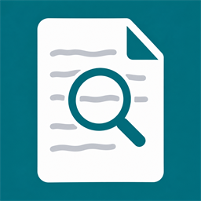

# Paperless-ngx Insights



Search your Paperless-ngx document archive and view documents directly in Home Assistant. Find invoices, letters and other documents without opening the Paperless interface first.

## Features

- **Document search:** Search titles, or titles and content. Multiple search terms are matched together.
- **Compact search card:** A simple list with five results per page and arrows for browsing.
- **Document overview card:** Thumbnails, document dates and an integrated preview, suitable for a dedicated dashboard tab.
- **Previews and downloads:** View PDFs in Home Assistant, download the PDF or original file, or open the document in Paperless.
- **Visual card editor:** Configure both cards through the interface.
- **English and German:** Cards and their editor follow your Home Assistant interface language automatically. Other languages use English. Setup dialogs are also available in English and German. Custom headings and document titles keep their original text.

The integration reads documents from Paperless. It does not modify or delete them.

## Installation

You need **Home Assistant 2026.10.4 or newer**, **HACS 2.0.5 or newer**, a reachable Paperless-ngx server and a Paperless API token with permission to read the documents you want to access.

### Using HACS

1. Open **HACS** in Home Assistant, then select **Custom repositories** from the menu.
2. Enter this repository URL and select **Integration** as the type:

   ```text
   https://github.com/VexMex/paperless-ngx-Insights
   ```

3. Add the repository, open **Paperless-ngx Insights** and select **Download**.
4. Restart Home Assistant.
5. Go to **Settings → Devices & services → Add integration** and search for **Paperless-ngx Insights**.
6. Enter your Paperless server address and API token. The optional **Browser address** is only needed if your browser uses a different address to open Paperless.

Both dashboard cards and the icon are included. You do not need a separate card repository.

### Manual installation

[Download the repository ZIP](https://github.com/VexMex/paperless-ngx-Insights/archive/refs/heads/main.zip), extract it and copy `custom_components/paperless_ngx_insights` to `/config/custom_components/paperless_ngx_insights/`. Restart Home Assistant, then add the integration as described above.

## Adding cards to your dashboard

After setup, reload your dashboard and select **Edit dashboard → Add card**. Choose:

- **Paperless-ngx Insights · Search** for the compact results list.
- **Paperless-ngx Insights · Document overview** for the larger view with thumbnails.

For a dedicated dashboard tab, use a **Panel** view with the document overview as its only card. The visual editor lets you adjust the heading, search scope, results per page and other options. The card resource is registered automatically for dashboards managed through the Home Assistant interface.

## Notes

- Currently, only **Home Assistant administrators** can access documents.
- PDF previews are limited to **20 MiB**. Larger PDFs can be downloaded.
- If your browser cannot display a PDF directly, you can show the first page as an image.
- The API token stays in the integration configuration. Do not put it in the card configuration.
- Change the interface language in your **Home Assistant profile**. No language setting is needed in the cards.

## Updates

Download updates through HACS, restart Home Assistant and reload your dashboard. For manual installations, replace the integration folder with the new version.

## License

[GNU General Public License v3](LICENSE).

